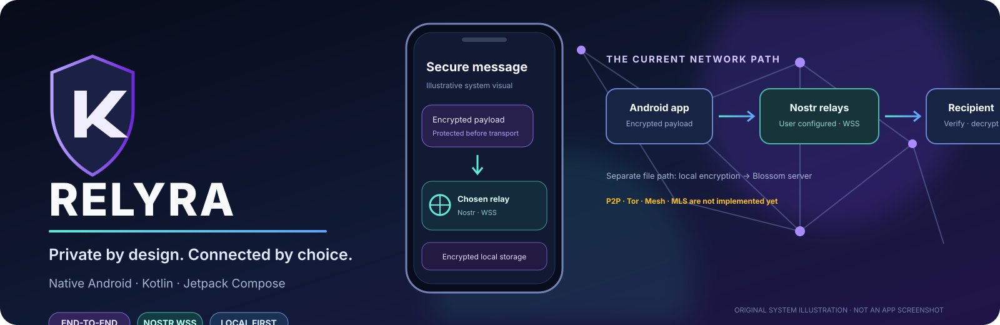
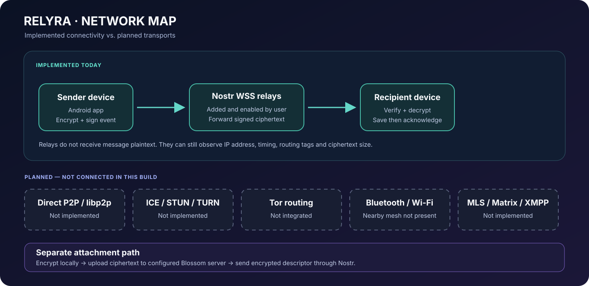
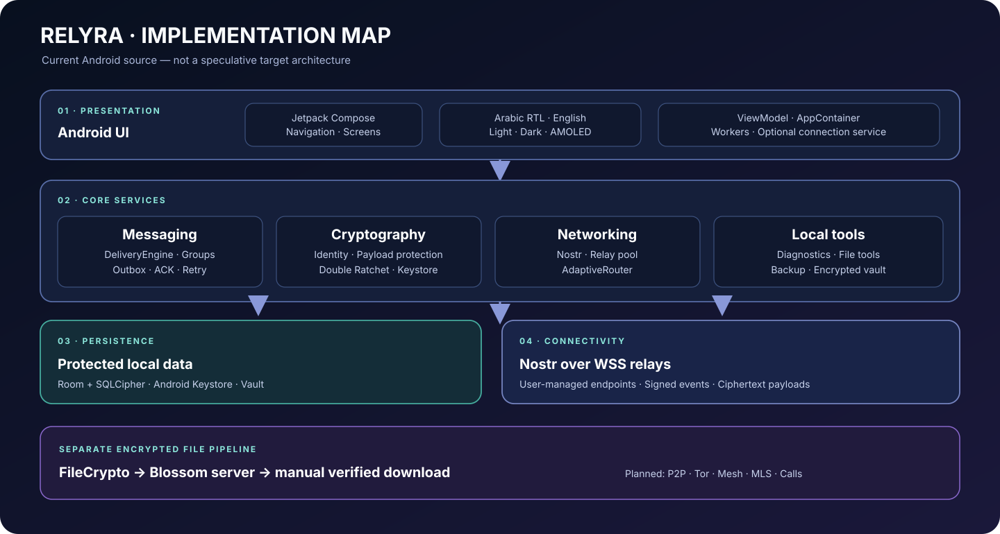
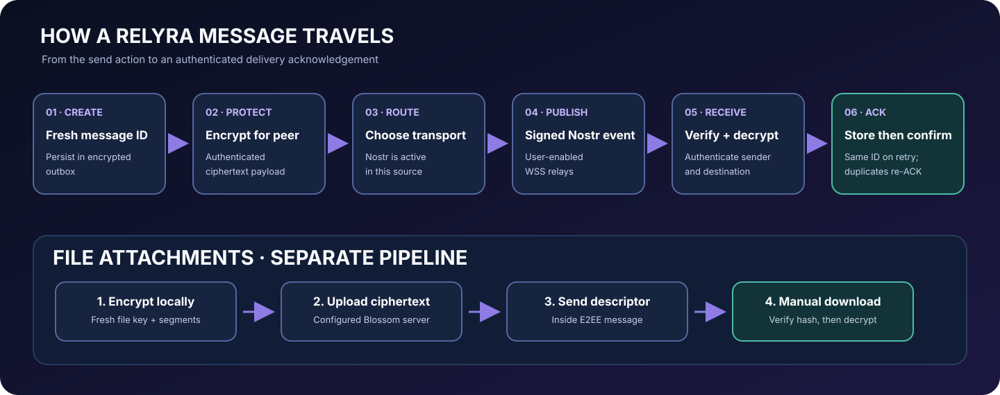

<p align="center"></p>
<p align="center"><a href="README_AR.md">العربية</a> · <a href="docs/ARCHITECTURE.md">Architecture</a> · <a href="docs/NETWORKING.md">Networking</a> · <a href="docs/ROADMAP.md">Roadmap</a> · <a href="docs/SPECIFICATION_CROSSWALK_AR.md">Specification status</a> · <a href="LICENSE">Apache 2.0</a></p>
<p align="center">
<a href="https://github.com/ibra8y3-web/RELYRA/actions/workflows/build.yml"></a>


</p>

<h1 align="center">RELYRA</h1>
<p align="center"><strong>Private by design. Connected by choice.</strong></p>
<p align="center">An Android communication project built around local identity, end-to-end encrypted messaging, and user-controlled network relays.</p>

> **Current implementation:** Version 0.9.0. Opt-in nearby paths include Bluetooth Classic for already-paired devices, Wi-Fi Direct, and Nearby LAN for known contacts. Nostr over user-configured secure WebSocket relays (WSS) remains the Internet relay/fallback path. Internet-wide libp2p and NAT traversal are not implemented. The diagrams below separate working paths from planned capabilities.

## At a glance

| **What works today** | **How it connects** | **Build & explore** |
|:--|:--|:--|
| Local identity and encrypted storage | Nostr over user-managed WSS relays | Kotlin · Jetpack Compose |
| Direct messages and groups | Encrypted payloads before transport | Android 10+ · JDK 17 |
| Encrypted attachments and local vault | Blossom for file blobs | Gradle 9.6.0 · CI workflow |

## What is RELYRA?

RELYRA is a native Android app written in **Kotlin** with **Jetpack Compose and Material 3**. It keeps identity and private app data on the device, encrypts message contents before transport, and lets the user choose the relay and file servers the app connects to.

The current source includes local identity, SQLCipher storage, direct conversations, groups and channels, Nostr relay transport, encrypted file transfer, diagnostics, passphrase-protected backup/restore, and an encrypted local vault.

## Features implemented in the current source

| Area | Included |
|---|---|
| **Identity** | On-device Ed25519 identity, public ID and fingerprint, signed contact cards, QR/link exchange and recovery key |
| **Local security** | Room + SQLCipher; database key protected with Android Keystore; biometric/device-credential lock |
| **Direct messages** | Persistent outbox, acknowledgements, delivery states, retries, backoff and duplicate suppression |
| **Message encryption** | X25519/HKDF/AES-GCM and one-to-one Double Ratchet sessions |
| **Network** | User-added WSS relays; WebRTC direct DataChannels; configurable HTTPS Kademlia presence discovery; bounded recovery/renegotiation; optional Bluetooth Classic, Wi-Fi Direct and Nearby LAN |
| **Groups / channels** | Membership roles and per-member message delivery using individual sessions |
| **File transfer** | Client-side encrypted files over user-configured Blossom-compatible servers |
| **Background work** | WorkManager retries and optional visible foreground connection service (subject to Android restrictions) |
| **On-device tools** | Hashes, hex/strings inspection, MIME detection, EXIF, archive inspection, APK metadata, a restricted WebView and a read-only PDF reader |
| **Diagnostics and resources** | Relay/server tests, database integrity, battery and memory, live app CPU and per-app RX/TX rates, filesystem availability and redacted report |
| **Backup / vault** | Passphrase-protected database backup/restore and encrypted local file vault |
| **UI** | Arabic RTL and English; light, dark and AMOLED themes |

## Visual system maps

### 1. Network map — what is connected today

Nostr is the registered messaging transport in this build. Dashed/grey nodes are future work, not active connections.

<p align="center"></p>

### 2. Application architecture

<p align="center"></p>

### 3. Message and attachment flow

<p align="center"></p>

Read the [Architecture guide](docs/ARCHITECTURE.md), [Networking guide](docs/NETWORKING.md) and [Nearby transport notes](docs/NEARBY_TRANSPORTS.md) for implementation detail.

## How a message travels

1. Create a fresh message ID and persist the outgoing message in the encrypted outbox.
2. Encrypt the payload for the recipient.
3. Select a ready registered transport in this order: Wi-Fi Direct, Bluetooth Classic, Nearby LAN, then Nostr.
4. A nearby connector authenticates the other device with a mutual Ed25519 challenge and transfers only the end-to-end encrypted payload; Nostr signs an event and publishes it to enabled WSS relays.
5. The recipient verifies, decrypts and stores the message before acknowledging it.
6. Automatic retries reuse the same message ID; a new user send gets a new ID.

**Attachments use a separate path:** encrypt the file locally, upload only ciphertext to a configured Blossom server, then send the file descriptor inside the end-to-end encrypted message. Downloads are manual and verified before use.

## Nearby transports

Public Internet presence discovery is optional and off by default. The app can publish a signed three-minute RELYRA identity lease to an operator-run Kademlia DHT through HTTPS gateways. Finding presence never adds a contact or authorizes messaging. WebRTC direct sessions use signed E2EE signaling and bounded recovery for previously approved peers. The deployable DHT/TURN service templates live in services/discovery; the repository does not host public services for users.\n\nBluetooth Classic, Wi-Fi Direct and Nearby LAN are optional and off by default. Bluetooth requires the phones to be paired first in Android Settings. Wi-Fi Direct requires the user to choose a discovered device and form a Wi-Fi P2P group. Nearby LAN requires both phones to share a Wi-Fi network or local hotspot. All three verify the RELYRA Ed25519 identity against an existing contact before accepting an encrypted message.

These transports are for nearby devices only. They do not provide Internet P2P, multi-hop mesh or Store & Forward through third-party phones. The public RELYRA ID is visible on a local network when Nearby LAN is enabled; use it only on a trusted network. See [Nearby transport details](docs/NEARBY_TRANSPORTS.md).

## Security and privacy

- Message content is encrypted before it reaches a relay.
- Local app data is stored in an SQLCipher-encrypted database; key material is protected with Android Keystore.
- Only known contacts with usable key material can exchange accepted messages.
- A relay transports encrypted events; it is not trusted with plaintext.
- WSS does **not** hide your IP address from the relay. Relays may observe connection timing, routing tags and ciphertext size.
- File servers can observe transfer metadata (such as IP, time and size) but receive encrypted blobs.
- RELYRA has not had an independent cryptographic security audit. This README is not a security certification.

## Not implemented yet

The following are **not** present in the current build:

- A project-operated public DHT/TURN cluster. The source includes a deployable Go libp2p Kademlia node, HTTPS gateway, coturn service and short-lived TURN credential API, but operators must deploy multiple public nodes and configure them. Android uses the HTTPS gateway, not an embedded libp2p host. Real network/NAT device validation remains pending.
- A bundled Tor client, in-app bridge configuration and Onion Services. An external Tor SOCKS5 service (e.g. Orbot) is supported for OkHttp traffic with Strict Mode and a Tor exit check; browser/WebView and nearby local links are separate.
- Bluetooth Low Energy mesh and third-party multi-hop Store & Forward. Bluetooth Classic and Wi-Fi Direct nearby transports are present, but are not Internet P2P.
- MLS group encryption. Current group messages are encrypted separately for each member using one-to-one sessions.
- Group file attachments and group read receipts.
- Communities, public group discovery and a RELYRA-operated relay/node network.
- Voice/video calls and multi-device synchronization.
- Matrix/XMPP interoperability, multi-device sync, plugin runtime, Local API, Server Studio, Desktop/Node tools and Developer Studio. The current WebView is restricted and the PDF reader is read-only; neither is a full browser or document editor.

Other limits: Android may defer background work due to battery policy or force-stop; backups exclude downloaded attachments, vault files and relay/file-server settings; restoring an older ratchet snapshot can affect conversations that continued after backup creation. See [Networking](docs/NETWORKING.md) and [Roadmap](docs/ROADMAP.md).

## Build from source

**Android requirements:** Android SDK Platform 37.0, Build Tools 37.0.0, JDK 17 and Gradle 9.6.0. **Service requirements:** Go 1.26 and Docker Compose for the discovery/TURN services. The repository does not currently include a Gradle Wrapper.

Run from the repository root:

```bash
gradle --no-daemon assembleDebug
gradle --no-daemon testDebugUnitTest

cd services/discovery
go test -race ./...
go vet ./...
```

Debug APK output:

```text
app/build/outputs/apk/debug/
```

GitHub Actions builds the debug APK, runs Android JVM tests, tests/vets the Go discovery service and builds its container on pushes, pull requests and manual dispatch. Download APK and test reports from the run's **Artifacts** section. Check the latest workflow result before treating a build as verified.

## Repository map

```text
app/src/main/java/org/relyra/app/
├── core/
│   ├── backup/       Passphrase-protected backup and staged restore
│   ├── crypto/       Identity, payload crypto, contact cards and ratchet
│   ├── database/     Room entities, DAOs, migrations and SQLCipher
│   ├── diagnostics/  Device and application diagnostics
│   ├── identity/     Identity and contact repositories
│   ├── messaging/    Delivery engine, envelopes and groups
│   ├── network/      WebRTC P2P, DHT HTTPS client, Nostr, LAN, Bluetooth and Wi-Fi Direct
│   ├── notify/       Message notifications
│   ├── storage/      Private attachment storage
│   ├── tools/        On-device file inspection tools
│   ├── transfer/     File encryption and Blossom transfer
│   └── vault/        Encrypted local file vault
└── ui/               Compose screens, navigation and theme

app/src/test/          JVM tests
services/discovery/      Go Kademlia DHT gateway, coturn/Caddy deployment and protocol tests
docs/                  Architecture, networking, roadmap, specification crosswalk and visual maps
.github/workflows/     Build and test automation
```

## Development principles

- **Real functionality only:** no fake connection indicators, demo messages or placeholder buttons.
- **Security first:** encrypt before transport; validate identities and inputs; document metadata exposure.
- **Tests with each feature:** success, failure, retry, malformed input and recovery.
- **Honest status:** a planned class or UI screen is not a completed capability.
- **Arabic and English:** new user-facing strings should support both languages and correct RTL layout.

## Contributing

Issues and pull requests are welcome. For substantial changes, describe the threat model, protocol choice, Android lifecycle impact and test plan. Do not publish exploitable security details in a public issue; coordinate disclosure privately.

---

<p align="center"><strong>RELYRA · Private by design. Connected by choice.</strong></p>
