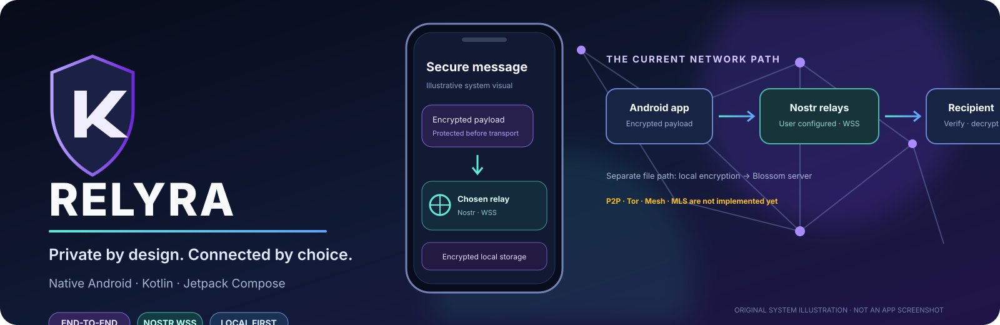
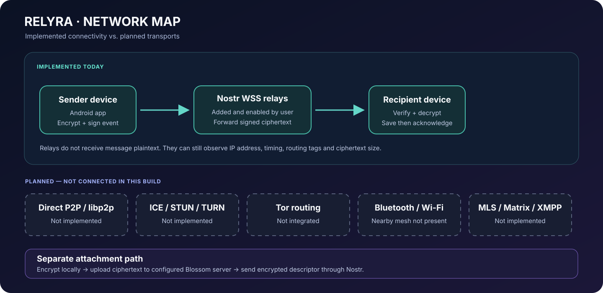
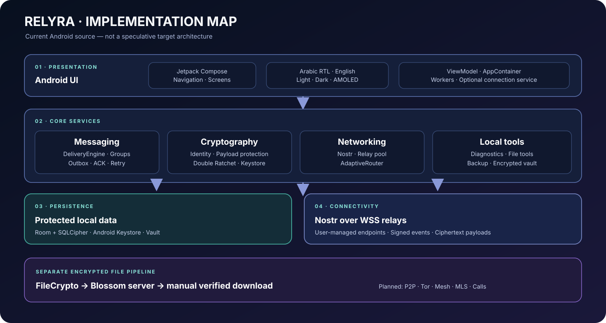
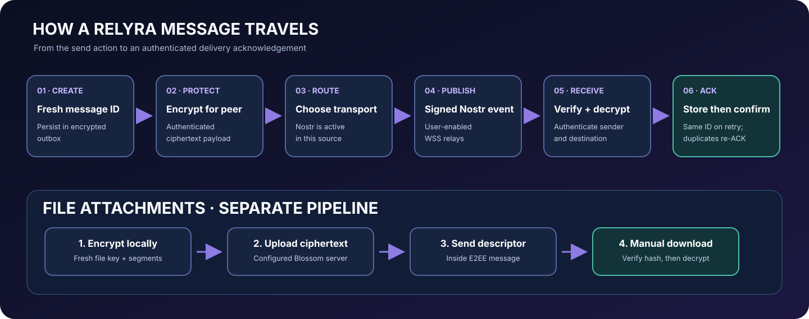

<p align="center"></p>
<p align="center"><a href="README.md">English</a> · <a href="docs/ARCHITECTURE.md">المعمارية</a> · <a href="docs/NETWORKING.md">الشبكة</a> · <a href="docs/ROADMAP.md">خطة التطوير</a> · <a href="docs/SPECIFICATION_CROSSWALK_AR.md">حالة المواصفات</a> · <a href="LICENSE">Apache 2.0</a></p>
<p align="center"><a href="https://github.com/ibra8y3-web/RELYRA/actions/workflows/build.yml"></a>   \n</p>

<h1 align="center">RELYRA — ريلايرا</h1>
<p align="center"><strong>خصوصيتك من التصميم. واتصالك باختيارك.</strong></p>
<p align="center">مشروع تواصل لأندرويد، يعتمد على هوية محلية وتشفير طرفي للرسائل وخوادم اتصال يتحكم المستخدم في اختيارها.</p>

> **حالة التنفيذ:** الإصدار الحالي 0.9.0. وسيلة نقل الرسائل الموجودة فعليًا هي Nostr عبر خوادم WebSocket آمنة (WSS) يضيفها المستخدم. الرسومات التالية خرائط للنظام وليست لقطات شاشة من التطبيق.

## فكرة RELYRA

RELYRA تطبيق أندرويد أصلي مكتوب بـ **Kotlin** باستخدام **Jetpack Compose وMaterial 3**. يحتفظ بالهوية والبيانات الخاصة على الجهاز، ويشفر محتوى الرسائل قبل نقله، ويتيح للمستخدم التحكم في خوادم الترحيل والملفات التي يتصل بها التطبيق.

المصدر الحالي يحتوي على أساس تطبيقي فعلي يشمل الهوية المحلية، التخزين المشفر، المحادثات الفردية والجماعية، اتصال Nostr، نقل الملفات المشفرة، التشخيص، النسخ الاحتياطي والخزنة المحلية.

## المميزات الموجودة في المصدر

| المجال | الوظائف المنفذة |
|---|---|
| **الهوية** | هوية Ed25519 محلية، معرف وبصمة، بطاقات جهات اتصال موقعة، QR ورابط ومفتاح استرداد |
| **التخزين الخاص** | Room مع SQLCipher، وحماية مفتاح قاعدة البيانات بواسطة Android Keystore |
| **الرسائل الفردية** | صندوق إرسال دائم، حالات تسليم، تأكيد استلام، إعادة محاولة ومنع تكرار |
| **تشفير الرسائل** | X25519/HKDF/AES-GCM وجلسات Double Ratchet بين شخصين |
| **الشبكة** | خوادم WSS يضيفها المستخدم، توقيع أحداث Nostr والتحقق منها واختبار الاتصال وإعادة الاتصال |
| **المجموعات والقنوات** | صلاحيات الأعضاء والمالك والمديرين وإرسال نسخة مشفرة لكل عضو |
| **الملفات** | تشفير الملف على الجهاز ونقله عبر خوادم متوافقة مع Blossom |
| **العمل بالخلفية** | WorkManager وخدمة اتصال أمامية اختيارية مع مراعاة قيود أندرويد |
| **الأدوات المحلية** | بصمات الملفات وHex والنصوص وتحديد النوع وEXIF وفحص الأرشيفات وبيانات APK |
| **التشخيص والموارد** | اختبار الخوادم وسلامة قاعدة البيانات والبطارية والذاكرة وقياس CPU وحركة الشبكة الخاصة بالتطبيق والمساحة المتاحة وتقرير منقح |
| **النسخ والخزنة** | نسخة احتياطية محمية بكلمة مرور وخزنة ملفات محلية مشفرة |
| **الواجهة** | العربية RTL والإنجليزية والوضع الفاتح والداكن وAMOLED |

## خرائط النظام

### خريطة الشبكة الحالية

Nostr هي وسيلة نقل الرسائل المسجلة حاليًا. العناصر المتقطعة في الرسم تمثل خططًا مستقبلية وليست اتصالات عاملة.

<p align="center"></p>

### خريطة معمارية التطبيق

<p align="center"></p>

### مسار الرسائل والملفات

<p align="center"></p>

للتفاصيل: [دليل المعمارية](docs/ARCHITECTURE.md) · [دليل الشبكة](docs/NETWORKING.md).

## كيف تنتقل الرسالة؟

1. ينشئ التطبيق معرفًا جديدًا ويحفظ الرسالة في صندوق الإرسال المشفر.
2. يشفر محتوى الرسالة للمستلم.
3. يختار الموجّه وسيلة نقل متاحة. الوسيلة المسجلة حاليًا هي Nostr.
4. يوقع موصل Nostr الحدث ويرسله إلى خوادم WSS التي فعّلها المستخدم.
5. يتحقق جهاز المستلم ويفك التشفير ويحفظ الرسالة ثم يرسل تأكيد الاستلام.
6. إعادة المحاولة تستخدم نفس معرف الرسالة، أما الإرسال الجديد فيحصل على معرف جديد.

**الملفات لها مسار منفصل:** يشفر التطبيق الملف محليًا، ويرفع النسخة المشفرة فقط إلى خادم Blossom، ثم يرسل وصف الملف داخل رسالة مشفرة طرفيًا. التنزيل يدوي ويتم التحقق من الملف قبل استخدامه.

## الأمان والخصوصية

- يُشفر محتوى الرسالة قبل وصوله إلى خادم الترحيل.
- بيانات التطبيق المحلية محفوظة في قاعدة SQLCipher مشفرة، ومفتاحها محمي بواسطة Android Keystore.
- يجب أن يكون الطرف الآخر جهة اتصال معروفة ولديه مفاتيح صالحة.
- خادم الترحيل وسيلة نقل وليس جهة موثوقة لحفظ محتوى الرسائل الأصلي.
- اتصال WSS لا يخفي عنوان IP عن الخادم؛ وقد يرى توقيت الاتصال ووسوم التوجيه وحجم البيانات المشفرة.
- خوادم الملفات ترى بيانات النقل مثل عنوان IP والوقت والحجم، لكنها تستقبل الملفات المشفرة.
- لم يخضع المشروع لمراجعة أمنية مستقلة للتشفير حتى الآن.

## الوظائف التي لم تُنفذ بعد

- اتصال مباشر بين الأجهزة P2P وlibp2p وICE/STUN/TURN.
- توجيه Tor وشبكة Bluetooth وWi-Fi Direct Mesh.
- تشفير المجموعات MLS؛ الرسائل الجماعية حاليًا تُشفر بصورة منفصلة لكل عضو باستخدام جلسات فردية.
- ملفات المجموعات وإيصالات قراءة المجموعات.
- المجتمعات واكتشاف المجموعات العامة وشبكة ترحيل تديرها RELYRA.
- المكالمات الصوتية والمرئية ومزامنة عدة أجهزة.
- التوافق مع Matrix وXMPP ومحرك الإضافات وLocal API والمتصفح وقارئ PDF وServer Studio.

قد يؤخر أندرويد العمل بالخلفية بسبب البطارية أو فرض إيقاف التطبيق. النسخ الاحتياطي لا يشمل الملفات المحملة ولا ملفات الخزنة ولا إعدادات الخوادم. كما أن استعادة جلسات Ratchet قديمة قد تؤثر على المحادثات المستمرة بعد إنشاء النسخة. راجع [الشبكة](docs/NETWORKING.md) و[خطة التطوير](docs/ROADMAP.md).

## البناء من المصدر

**المتطلبات:** Android SDK Platform 35 وBuild Tools 35.0.0 وJDK 17 وGradle 8.10.2. المستودع لا يحتوي حاليًا على Gradle Wrapper.

نفّذ من مجلد المشروع:

```bash
gradle --no-daemon assembleDebug
gradle --no-daemon testDebugUnitTest
```

ينتج ملف APK داخل:

```text
app/build/outputs/apk/debug/
```

يقوم GitHub Actions ببناء APK وتشغيل اختبارات JVM عند الدفع أو فتح طلب دمج أو التشغيل اليدوي. حمّل APK وتقارير الاختبار من قسم Artifacts في تشغيل Workflow، وتحقق من نتيجة آخر تشغيل قبل اعتبار البناء ناجحًا.

## هيكل المستودع

```text
app/src/main/java/org/relyra/app/
├── core/
│   ├── backup/       النسخ الاحتياطي والاستعادة المحمية
│   ├── crypto/       الهوية وتشفير المحتوى وبطاقات الاتصال وRatchet
│   ├── database/     Room والجداول والترحيلات وSQLCipher
│   ├── diagnostics/  تشخيص الجهاز والتطبيق
│   ├── identity/     الهوية وجهات الاتصال
│   ├── messaging/    محرك الرسائل والأغلفة والمجموعات
│   ├── network/      Nostr وخوادم الترحيل والموجّه
│   ├── notify/       إشعارات الرسائل
│   ├── storage/      تخزين المرفقات
│   ├── tools/        أدوات فحص الملفات
│   ├── transfer/     تشفير الملفات ونقل Blossom
│   └── vault/        خزنة الملفات المشفرة
└── ui/               شاشات Compose والتنقل والمظهر

app/src/test/          اختبارات JVM
docs/                  المعمارية والشبكة وخطة التطوير ومطابقة المواصفات والخرائط
.github/workflows/     أتمتة البناء والاختبار
```

## مبادئ التطوير

1. **وظائف حقيقية فقط:** لا مؤشرات اتصال وهمية ولا رسائل تجريبية ولا أزرار شكلية.
2. **الأمان أولًا:** التشفير قبل النقل والتحقق من الهوية والمدخلات وشرح البيانات الوصفية المكشوفة.
3. **الاختبار مع كل ميزة:** نجاح وفشل وإعادة محاولة ومدخلات غير صحيحة واستعادة الحالة.
4. **حالة صادقة:** وجود شاشة أو واجهة برمجية لا يعني أن الميزة مكتملة.
5. **العربية والإنجليزية:** دعم اللغتين واتجاه RTL في كل النصوص الجديدة.

## المساهمة

نرحب بالمشكلات وطلبات الدمج. عند اقتراح ميزة كبيرة، وضح نموذج التهديد والبروتوكول وتأثيرها على دورة حياة أندرويد وخطة الاختبار. لا تنشر تفاصيل ثغرة قابلة للاستغلال في مشكلة عامة.

---

<p align="center"><strong>RELYRA — خصوصيتك من التصميم، واتصالك باختيارك.</strong></p>
