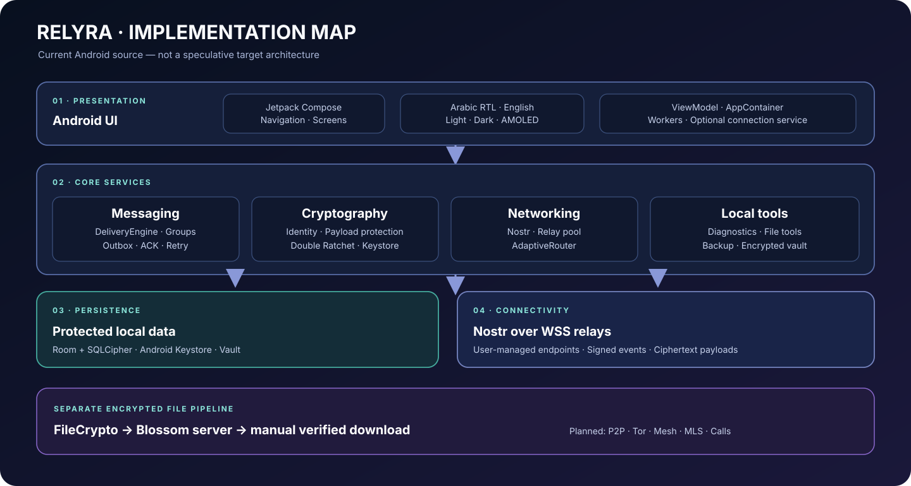
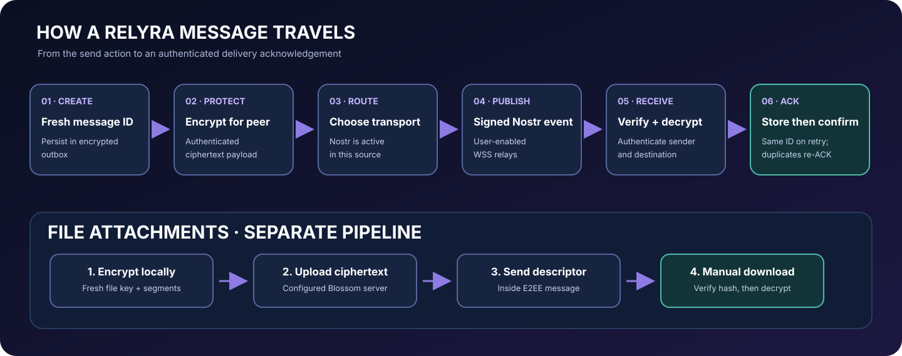
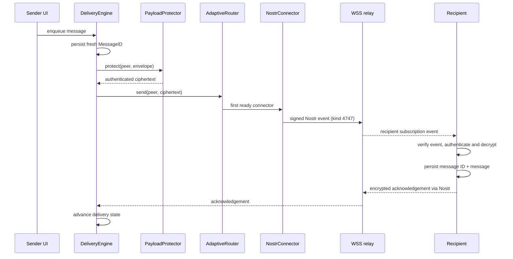

# RELYRA architecture

This document describes the implementation currently present in the repository. It is not a claim that planned transports or services are already available.

## Layer map

| Layer | Main responsibility | Current implementation |
|---|---|---|
| UI | User interaction, Arabic/English presentation | Jetpack Compose screens and navigation |
| Application | Dependency wiring and lifecycle | AppContainer, ViewModel, workers and optional connection service |
| Messaging | Queue, envelope validation, delivery state, group fan-out | DeliveryEngine, Group engine and persistent Room records |
| Cryptography | Identity, peer authentication, payload protection and ratchet state | Tink-backed crypto, X25519 and Double Ratchet |
| Persistence | Private application state | Room + SQLCipher; key material wrapped by Android Keystore |
| Transport | Carry already encrypted wire payloads | Transport contract, Connector contract, AdaptiveRouter and NostrConnector |
| File transfer | Encrypt, upload and retrieve file blobs | FileCrypto and Blossom client |
| Local utilities and resources | Diagnostics, safe file inspection and live app resource samples | Diagnostics, tools, vault and resources packages |

## Direct message path

The transport boundary receives ciphertext only. A transport must not be given plaintext message bodies or ratchet private keys.

## Attachment path

1. The app creates a random file key and encrypts the file locally in authenticated segments.
2. The ciphertext is uploaded to a user-configured Blossom-compatible server.
3. The file descriptor (including server address, hashes, size and file key) is included in the end-to-end encrypted message.
4. The recipient manually starts a download, validates the blob and decrypts it locally.

The file server can observe the uploader's IP address, upload time and ciphertext size. It does not receive the plaintext file from the RELYRA upload path.

## Persistence and recovery

- The Room database is encrypted with SQLCipher.
- The database passphrase is stored through Android Keystore protection.
- Identity and ratchet-related records are part of the encrypted app database.
- Backup export uses a user-chosen passphrase and authenticated encrypted segments.
- Restore is staged and applied after an app restart; it is not a live merge with the current database.
- The local Vault stores encrypted files separately and is currently excluded from backup.

## Transport contract

The transport extension point is the messaging Transport interface. A Connector adds a readiness check. AdaptiveRouter iterates ready connectors in the supplied order and records the successful path.

At present, NostrConnector is the registered transport. The abstraction does not itself implement libp2p, direct sockets, Tor, Bluetooth or Wi-Fi Direct. A new connector must have its own connection lifecycle, identity binding, replay handling, bounded resource use and tests before it is registered.

## Security boundaries

- **Local device:** Android Keystore protects the database secret; device compromise or malware with access to an unlocked app remains a risk.
- **Relay:** sees network metadata and encrypted event envelopes; it is not trusted with message plaintext.
- **File server:** sees upload/download metadata and ciphertext; attachment keys are carried inside the encrypted message descriptor.
- **Peer:** must be a known contact with usable key material; malformed, unauthenticated or untrusted messages are dropped.
- **Backup file:** confidentiality depends on the user's passphrase. The passphrase is not stored in the app.

## Repository source map

- `core/crypto`: identity, contact cards, payload crypto and ratchet.
- `core/database`: Room entities, DAOs, migrations and SQLCipher initialization.
- `core/messaging`: message contracts, delivery engine, envelope codec and groups.
- `core/network`: relay URL manager, relay WebSocket client, Nostr protocol and router.
- `core/transfer`: file encryption and Blossom transfer.
- `core/backup` and `core/vault`: backup/restore and encrypted local files.
- `ui`: Compose screens and user workflows.
