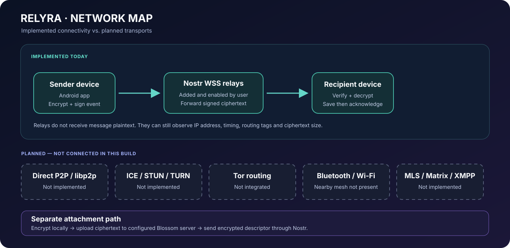

# RELYRA networking: current state and extension rules

## Current network map

## Nearby direct transports

Three opt-in nearby transports are registered ahead of the Nostr relay path:

- **Wi-Fi Direct:** Android discovers peer devices and lets the user select one to form a Wi-Fi P2P group. A socket listener starts on the group network; the group owner and connected clients perform a signed identity probe before being treated as peers.
- **Bluetooth Classic:** RELYRA listens on an RFCOMM service and checks already-bonded devices. The user must pair devices in Android Bluetooth settings first. BLE discovery and in-app pairing are not included.
- **Nearby LAN:** Android NSD/mDNS advertises the public RELYRA ID on the current local network and discovers contacts already in the address book.

All three use the shared NearbyHandshakeProtocol: each side signs a fresh nonce-bound transcript with the existing RELYRA Ed25519 seed; the remote key is derived from the public RELYRA ID and must belong to a known, unblocked contact. Only after mutual verification does the connector pass an opaque, already end-to-end-encrypted payload to the receiving DeliveryEngine. Frame size is bounded at 256 KiB.

- All three switches are off by default and require explicit user opt-in. Wi-Fi Direct and Bluetooth runtime permissions are requested only when enabled.
- Wi-Fi Direct requires both phones to join the same Wi-Fi P2P group. Bluetooth currently supports already-paired RFCOMM peers only.
- Nearby LAN still requires the same IP LAN or local hotspot and exposes the public RELYRA ID to that LAN while enabled.
- The current router order is Wi-Fi Direct, Bluetooth Classic, Nearby LAN, then user-configured Nostr relays.
- Source implementation and JVM handshake tests are present in this change; actual two-device tests, Android vendor compatibility and background behaviour remain release gates.
- These transports do not provide Internet P2P, libp2p, NAT traversal, BLE mesh or multi-hop forwarding.

## Internet relay transport

The current relay-based Internet transport is **Nostr over user-configured secure WebSockets (WSS)**. It is used after nearby direct transports or when no nearby path is available.

- No relay is silently enabled by default; users manage their own relay list.
- Relay URLs are normalized to WSS and can be probed with a WebSocket connection plus a Nostr REQ/EOSE exchange.
- Nostr events use Schnorr signatures over secp256k1 (BIP-340) and NIP-01 event serialization.
- RELYRA message packets use kind 4747 events and recipient tags.
- The recipient verifies the event, checks the destination tag, then passes the payload to the end-to-end decryption and delivery engine.
- The pool maintains inbox subscriptions, reconnects after disconnects and waits for relay OK responses when publishing.
- NetworkManager persists relay configuration locally. The relay list is not part of the current backup export.

## What is not implemented

The presence of a Connector interface and AdaptiveRouter is only an extension point. It is not proof of an active transport. These are not currently registered/implemented:

| Transport or capability | Status |
|---|---|
| Internet P2P / direct sockets across separate networks | Not implemented |
| libp2p | Not implemented |
| ICE/STUN/TURN traversal | Not implemented |
| Peer-to-peer multi-hop Store & Forward | Not implemented |
| Embedded Tor daemon, bridge configuration inside RELYRA and Onion Services | Not implemented |
| External Tor SOCKS proxy for shared OkHttp traffic | Implemented in source; requires a running local Tor service and a successful Tor exit check |
| Bluetooth Low Energy discovery/mesh | Not implemented |
| Matrix / XMPP bridges | Not implemented |
| Push relay infrastructure operated by RELYRA | Not implemented |

Blossom is a separate encrypted-file storage path, not a peer-to-peer messaging transport.

## AdaptiveRouter contract

A connector must:
1. Implement the existing Transport contract and expose a stable, human-readable name.
2. Return not-ready when it cannot currently deliver, so the delivery engine does not advance encryption state for an unavailable route.
3. Carry only the already-protected wire payload.
4. Return Accepted or Relayed only when the connector has actually accepted the payload; return Unavailable for temporary connectivity problems; return Rejected only for permanent failures.
5. Preserve the same message identifier across transport retries and never invent a new application message during a retry.

AdaptiveRouter attempts ready connectors in their configured order. The successful connector name is exposed through lastPath. A future connector must not be added to the registered list until its lifecycle and tests are complete.

## Network privacy and threat notes

- WSS protects the connection in transit to the relay; it does not hide the client's IP from that relay.
- Relays can observe event timing, connection metadata, public routing tags and ciphertext size.
- End-to-end encryption protects message contents, but does not make the network anonymous.
- A malicious relay can withhold, delay, reorder or replay events. Application-level authentication, message identifiers and deduplication are still required.
- File servers observe file transfer metadata. Attachment encryption protects file contents and keys from the server.
- Do not describe RELYRA as globally Tor-protected or anonymous. The Tor SOCKS option is an opt-in integration with an external local Tor service (for example, Orbot).
- When Nearby LAN is enabled, the public RELYRA ID is visible to devices on the local network. Enable it only on a trusted LAN; application message content remains end-to-end encrypted.
- Wi-Fi Direct discovery exposes Android device names and Wi-Fi P2P device addresses to the local discovery layer; neither value is accepted as a RELYRA identity. The Ed25519 challenge is required.
- Bluetooth currently uses Android's bonded-device list and RFCOMM service UUID. It does not perform BLE scans and does not accept an unpaired device.
- The durable local outbox retries messages when a configured transport becomes available, and Nostr relays can store events for later inbox retrieval. This is not an intermediary-device mesh: nearby peers do not yet hold and forward third-party messages.

## External Tor SOCKS integration

RELYRA can use a local Tor SOCKS5 endpoint supplied by another Android app/service, such as Orbot. Orbot's default SOCKS endpoint is 127.0.0.1:9050. RELYRA does not bundle a Tor daemon or configure bridges itself; bridge and transport setup stays in the Tor service.

- The shared OkHttp client uses a live ProxySelector, covering Nostr WSS connections, Blossom file-server requests and other OkHttp traffic.
- The proxy selector keeps destination hostnames unresolved for SOCKS routes so target DNS resolution is performed through the SOCKS proxy.
- **Strict mode** returns only the SOCKS route. It does not provide a direct fallback; if the local proxy is unavailable, new OkHttp requests fail closed.
- Non-strict mode tries SOCKS first and then explicitly allows a direct connection. It can expose the device IP and must not be described as strict Tor routing.
- A change to Tor settings restarts existing Nostr relay WebSockets so they do not remain on an older route. In-flight HTTP requests may finish on their already-selected connection; new requests use the current setting.
- The embedded WebView does not use RELYRA's OkHttp proxy and is blocked while Tor SOCKS mode is enabled. Use a Tor-enabled browser or the Tor service's VPN mode for browser traffic.
- Bluetooth Classic, Wi-Fi Direct and Nearby LAN are local direct transports, not Tor routes. They remain separate and are not hidden by the Tor SOCKS option.
- The app verifies the external route by requesting the Tor Project IP-check API and requiring its IsTor response. This is a route check, not a cryptographic anonymity audit or a guarantee against all traffic correlation.

## libp2p integration decision

The upstream Kotlin/JVM candidate has an Android sample, but it does not currently provide all pieces required for global discovery and dependable NAT traversal. RELYRA's version-by-version component review and release gate are in [LIBP2P_EVALUATION.md](LIBP2P_EVALUATION.md). No production dependency is added until the Android and cross-network proof of concept passes.

## Requirements for a future direct-P2P connector

Before registering one, implement and test:
- Explicit user consent and clear disclosure before exposing a listening endpoint.
- Peer discovery with authenticated identity binding; discovery data alone must never authorize a peer.
- NAT traversal strategy with bounded retries and relay fallback.
- Connection timeouts, cancellation, backpressure and limits for concurrent peers.
- Replay protection, duplicate delivery handling and reconnect semantics consistent with DeliveryEngine.
- Android lifecycle behaviour, foreground execution requirements and battery/network restrictions.
- Tests for unavailable peers, forged peer identities, duplicate packets, disconnect during send and fallback to Nostr.

## Verification checklist

For every connector, record:
- Unit tests for protocol parsing and all SendOutcome branches.
- Integration tests with a local controllable endpoint.
- A real-device test on Wi-Fi and mobile data.
- Background/restart/force-stop behaviour and battery cost.
- Whether IP addresses, public identifiers, timing or other metadata are exposed.
